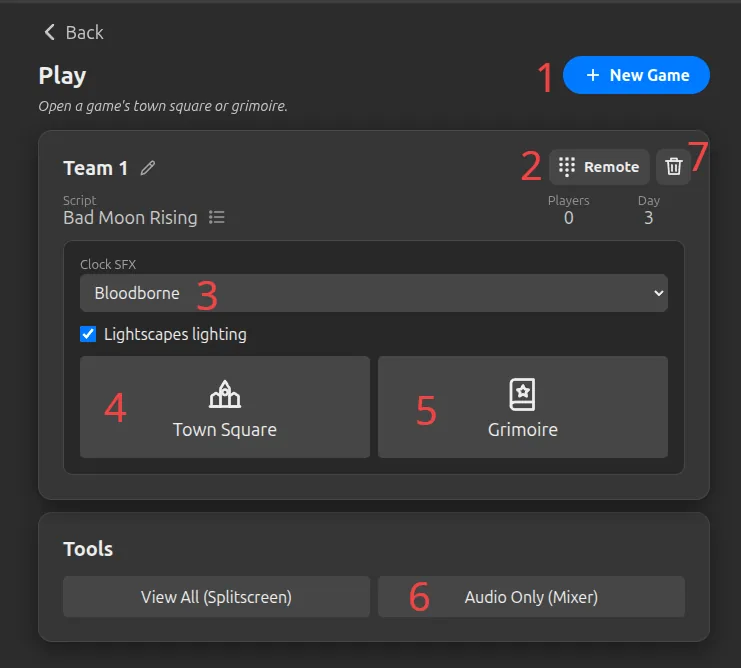
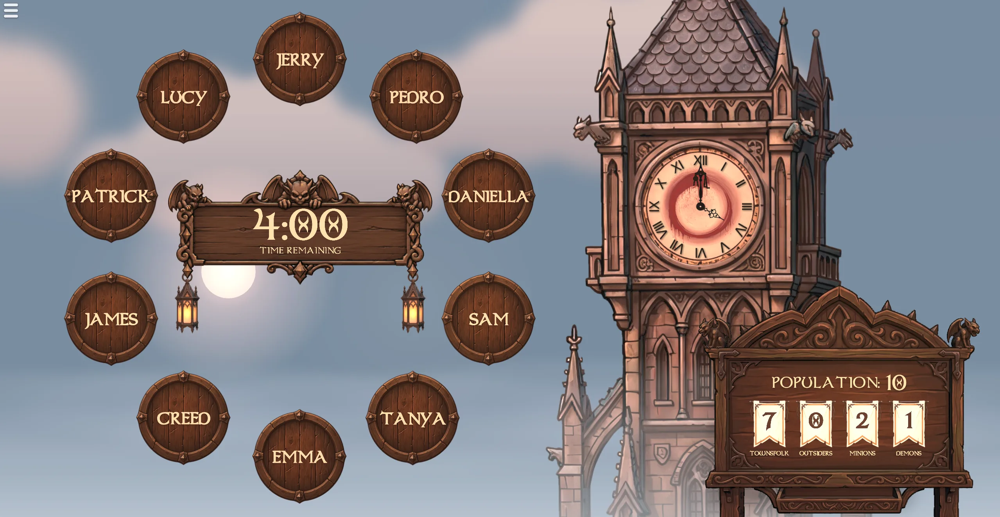
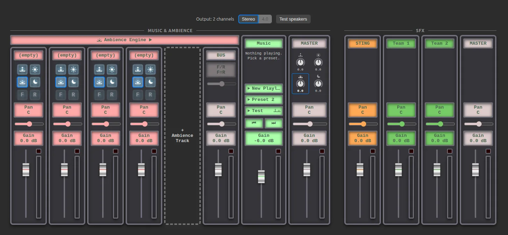

# Quickstart: your first game

## 1. Create a game

- On the home screen, press **Play**

- Press the **New Game** button(1). A card called "Team 1" appears.
- To rename it, press the pencil beside the name. The name is shown on the town square.

A "game" is one clock and, optionally, one grimoire. Running two games simultaneously? Create a game for each.

## 2. (OPTIONAL) Put the clock on the big screen
On the device connected to your big screen:
- Click the **Town Square** button (4) on your game's card.
- Make the browser full screen (usually `F11`).

You'll see the clock, the day number and the player count. If the 3D clocktower runs slowly on that device, open the
☰ menu (top left) and choose a simpler **Display Mode**.

## 3. (Optional) Enable ambience & sound effects
On the device connected to your sound system, click the **Audio Only (Mixer)** button (4) at the bottom of the play page

> NOTE: If the page isn't playing back any audio, click it. Browsers require user interaction before playing back any audio.

> For more info, see: [Understanding the audio mixer](./understanding_the_audio_mixer/index.md)

## 4. (Optional) Open the remote on your phone

On your phone, press **Play**, then the **Remote** (2) button at the top right of your game's card.

The remote shows the day and player count, the phases of the day (**Morning → Day → Dusk → Night**), the time left,
and one big button that always moves the game on to the next step.

> See: [Understanding the remote](./understanding_the_remote.md)

Made a mistake with the day number? Tap **Game** and use the Day **−** / **+** buttons.

## 5. (Optional) Add a bell sound

A new install has no sounds, so the clock is silent until you add some:

1. Go to **Settings → Audio Settings**. Under **Clock SFX**, press **+ Clock SFX Preset**.
2. Give it a name and upload a sound for **End of Day**. You can also add **Start of Day** and **Reminder Bell**
   sounds. Save.
3. Back on **Play**, choose your new preset in the game's **Clock SFX** dropdown. (3)

If two screens in the same room both show the town square, the bells will echo. Untick **Audio Engine** in the ☰ menu
on all but one of them.

## 6. (Optional) Use the virtual grimoire

The virtual grimoire is a tablet-friendly board of character tokens, reminders and player names. It works out the
night order for you and shows players' seats, deaths and ghost votes on the big screen.

### Get the characters and scripts (once)

A new install doesn't have any characters or scripts yet. With the server connected to the internet:

1. **Settings → Characters → Wiki Scraper → Scrape all.** This downloads every official character. It takes a few
   minutes.
2. **Settings → Scripts → Wiki Scraper → Scrape all.** This adds *Trouble Brewing*, *Bad Moon Rising* and
   *Sects & Violets*.

Got a custom script from the official Script Tool? Use **Settings → Scripts → Import** with its JSON file.

### Set up a game

1. On **Play**, press **Grimoire** on your game's card, then **Set up a new game** (the plus) in its menu.
2. Follow the steps along the top: pick the **script**, the **number of players**, then either a saved **preset** or
   **New Game** to pick the characters yourself. Tap a token to choose it; the counter at the top shows how many of
   each type you need.
3. Optionally prepare **bluffs** for the demon.
4. On the last step, choose how players get their characters:
   - **Draw tokens** — pass the device round the table. Each player taps a number, sees their character in private,
     types their name and passes it on to the next player round the table. Their seats are filled in for you.
   - **Go straight to grim view** — The tokens are randomly placed in a circle. Tap each seat's token to type the player's name, and use the auto arrange button in the virtual grim's side menu to evenly space all tokens once you're happy with the player arrangement.

Either way the game is ready at dusk on day 0, for the first night.

### During the game

- **Tap a token** to name the player, mark them dead, use their ghost vote, change their alignment or character, or
  **Show** their character full-screen to a player.
- **Drag tokens** to move them, and drag **reminders** from a token's popup onto the board.
- The **numbers on the tokens** are tonight's wake order. The **night order** button lists the whole night with
  what to do for each character.
- The clock in the middle of the board works like the remote, so you can run the whole game from the tablet.

### End the game

Press **End game** in the grimoire's sidebar and choose **Good victory**, **Evil victory** or **No result**. The
grimoire is cleared, ready for the next setup; the game's clock and name stay.

## What next?

- [Finding your way around](finding-your-way-around.md) — every page in the app and what it does.
- [Frequently asked questions](faq.md) — fixes for common problems.
- The [developer documentation](/help/developer) covers every feature in full, including audio, music and lighting.
