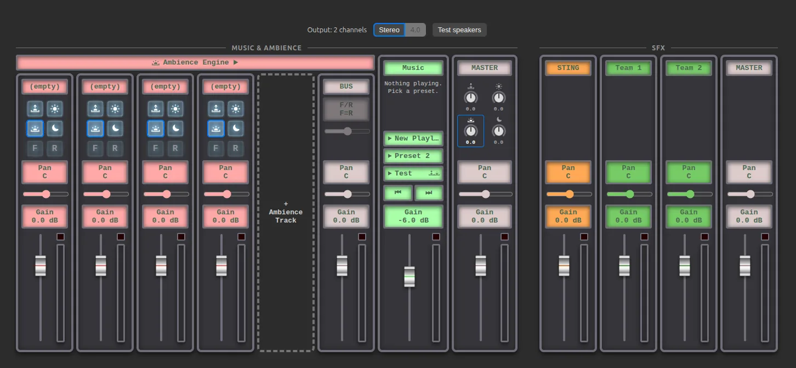
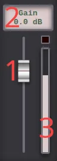
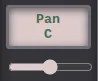
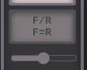
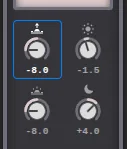
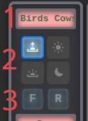
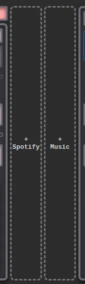
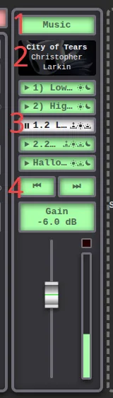

# Understanding the audio mixer

## Overview
The mixer is split into two submixers; the Music & Ambience mixer that controls everything related to the Ambience Engine, and the SFX mixer that is responsible for game sound effects.

### The "Master" and "Bus" channel strips
Each mixer has a master channel strip. All strips in the mixer get routed through the master channel strip, letting you controls the overall volume and pan.

The "Bus" channel strips are similar to masters, but for a specific group. Right now, there is one "Bus" strip for all the ambience tracks that lets you adjust the volume and pan of the ambience assets seperately from the music.

### Volume Control

1. This slider lets you adjust the volume. Drag the slider vertically to adjust the volume - these changes will synchronise across all devices. Double clicking this thumb resets to 0dB.
2. Clicking the gain display will mute the channel strip for the local device only (not available in remote mode). This is used to play sound effects for a specific game or room. This setting is stored locally on the device.
3. This level meter shows you the levels of the audio running through the channel strip.

### Panning
- **Left/Right Panning** 
     
    Pan between left and right channels. Double-clicking resets the pan.
- **Front/Back Panning** 
     
    Pan between front and rear speakers (this is only available with 4.0 output mode)

## Ambience Controls
The ambience engine offers additional controls to customize the experience

### Game phase trims (Master)
> See [Understanding the game's phases](./understanding_the_game_phases.md)

This section of the ambience engine's Master channel strip applies an additional volume boost/duck to the whole ambience engine based on the game phase.

From top-left to bottom right the knobs are: 
Morning, Day, 
Dusk, Night

- Click and drag the knob vertically to adjust the trim
- The value below each knob shows the volume applied (in dB)
- A blue box around a knob shows the current game's phase

### The Ambience Channel Strip

1. Clicking the title opens up the list of available ambience assets. This is synchronised between all instances.
2. The 4 phase buttons let the user select whether the asset is active across the 4 game phases. Click to toggle.
3. The 2 F and R buttons are only available with 4.0 output. The user uses these to route the ambience to the front speakers and/or to the back speakers. The playback position of ambience played out of the rear speakers is always offset by 50% of the track's duration - i.e. if an asset if 1 minute long, the ambience played out of the rear speakers is always 30s ahead of the ambience played out of the front speakers.

## Music
The music channel strip is part of the Music & Ambience mixer.
The first time you open this page, there won't be any music player(s), you'll have to initialize them.

Clicking one of the dotted outlines will initialize that player.

> NOTE: The spotify music player is only available if the server has been configured with Spotify API credentials (see developer docs)

Both mixers behave very similarly, and only 1 will ever play at a time (selecting a preset on one player while another is actively playing will trigger a smooth crossfade transition between the two).

1. Clicking the music player top section will over general playback controls and the ability to release the player instance
2. The section immediately below the title shows the now-playing track.
3. Below that is a list of available presets. Clicking a preset once will schedule the preset to load on the next game phase transition. Clicking a second time will immediately transition to the new preset.
4. Basic skip buttons that let you skip tracks or go back.

## What next?
- [Understanding the remote](./understanding_the_remote.md)
- [Understanding the game phases](./understanding_the_game_phases.md)
- [Understanding music presets](./understanding_music_presets.md)
