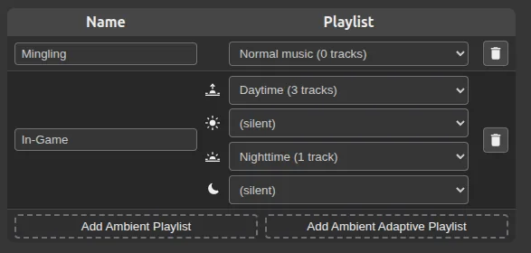

# Understanding music presets

 
*Preset editor, at Settings > Music > Presets*

The music player in the ambience engine has two preset types:
1. "Standard" presets are regular playlist that plays continuously throughout the game
2. "Ambient Adaptive" presets will seamlessly switch betwen playlists or fade out to silence based on the game [phase](/help/quickstart/understanding_the_game_phases).

## What next?
- [Understanding the game phases](/help/quickstart/understanding_the_game_phases)
- [Understanding the remote](/help/quickstart/understanding_the_remote)
