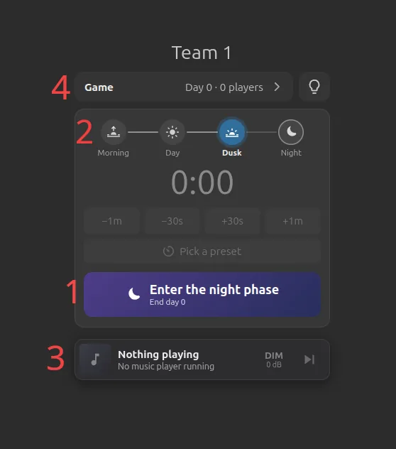
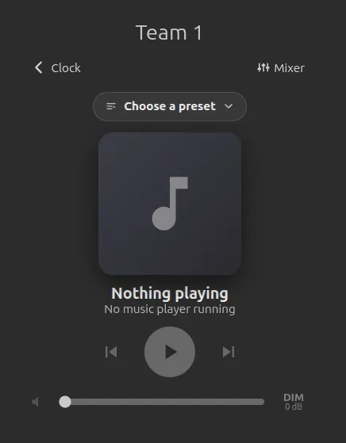
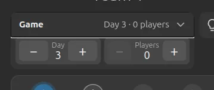

# Understanding the remote
The remote can accessed via the "Play" page by clicking on the "Remote" button of a game's panel (See [Quickstart: your first game](./index.md))

1. **Next phase button** 
This is the main button you'll be using most. Pressing it progresses the game to the next [phase](/help/quickstart/understanding_the_game_phases)
2. **Phase track** 
This section shows which phase the app is in. Tapping any phase sets the app state to that [phase](/help/quickstart/understanding_the_game_phases)
3. **Music controls** 
This section lets you control the music.
   - Tapping the "DIM" button makes the music quieter
   - Tapping the ">|" button skips to the next track
   - Tapping anywhere else in that section brings up the full music controls overlay 
 
      Here you can load a music [preset](/help/quickstart/understanding_music_presets), play, pause, control the volume, or open the full audio mixer remote that lets you control every audio source in the app remotely. 
      An example of using presets is switching from light-hearted playlists at the start of the game, to more intense playlists as the game nears its end.
      > If the music player says "No music player running", make sure the music channel strip is active in your ambience host (See game setup). Once there's an active music player, the music controls will automatically connect to it.
4. **Game controls** 
This section shows other game state info. Clicking this section reveals controls to set the day or manually change the number of players. 

## Running the game

1. **Set the player count.** Tap the **Game** bar at the top of the remote and use the Players **−** / **+**
   buttons. The town square shows how many townsfolk, outsiders, minions and demons that means.
2. **First night.** Tap **Night**. Every screen turns to night while you wake the characters.
3. **Morning.** Press **Morning of day 1**. The clock is set but not counting yet — a good moment for announcements.
4. **Start the day.** Press **Start the day** and pick how long the discussion lasts, e.g. *5 Minutes*. The clock
   counts down on every screen.
5. **Need more time?** Use **+30s** or **+1m** while it counts down (or **−30s** / **−1m** to hurry things along).
6. **End of the day.** When the time runs out the game moves to **Dusk** and the town square calls everyone back
   for nominations. To end the day early, press **End the day**, then press it again to confirm.
7. **Night falls.** When the execution is done, press **Night falls**.
8. Next morning press **Morning of day 2**, and so on until the game is over.

## What next?
- [Understanding the game phases](./understanding_the_game_phases.md)
- [Understanding the audio mixer](./understanding_the_audio_mixer/index.md)